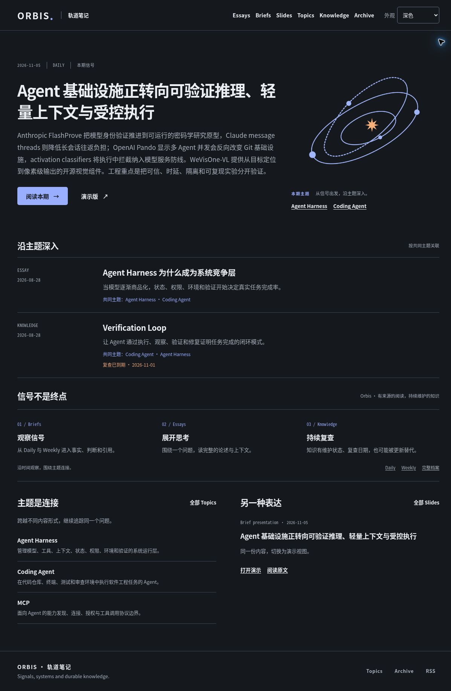
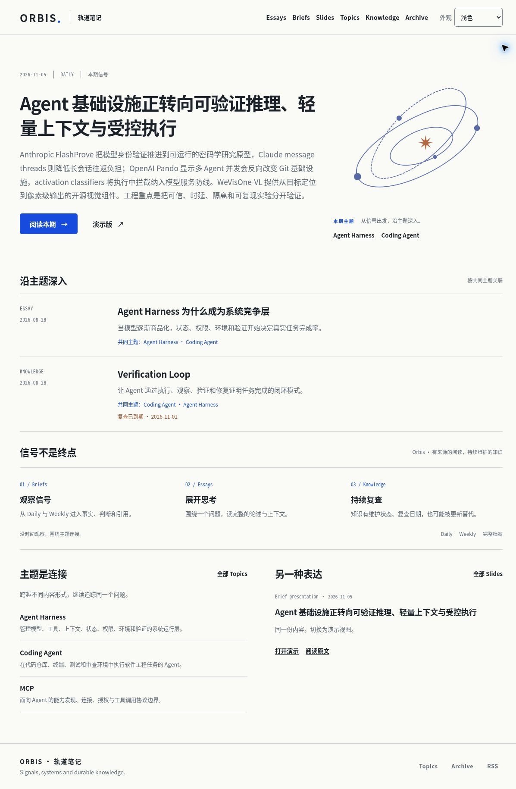

# Orbis · Orbital Notes implementation review

2026-11-05. Continuation of PR #73, following the selected light and dark Orbital Notes concepts. This is a repository implementation, not the generated concept image.

Independent final local review: **9.1/10**, with no remaining P0/P1/P2 issue in the reviewed flows. See [design QA](../../design-qa.md) for the weighted rubric and limits.

## What the visual language means

Orbis is a structured publishing system for Briefs, Essays, Topics, Knowledge and presentations, not a fictional astronomical data product. The implementation follows [README](../../README.md) and the existing [product scope](../planning/site-v2/00-product-scope.md):

- The current published Brief is the primary reading entry. Its title, date, summary and links come from the content collection.
- The orbital illustration is a decorative brand metaphor. It carries no confidence, provenance, ranking or analytics claims.
- Real Topic links identify the current issue's subjects. “沿主题深入” includes only public Essay/Knowledge entries with shared topics, sorted by the existing related-content rules. The shared topics are displayed.
- Briefs, Essays and Knowledge have different roles: observe signals, develop an argument, maintain reusable knowledge. This is navigation, not an invented automatic conversion pipeline.
- Knowledge retains actual review dates and lifecycle status. The current Verification Loop entry correctly says its 2026-11-01 review date is due, rather than claiming freshly verified knowledge.
- A Brief presentation is another view of the same source, not an independent conclusion.

No editorial content, source identity, author identity or content schema was changed. The previous generic hero and repeated card treatment were replaced with a lead story, related reading rows and a compact content index.

## Appearance architecture

- Shared semantic tokens cover page/surface/text/muted/link/button/border/tag/focus roles. Light and dark are the same design under different light conditions.
- The default is **follow device**. A three-state, 44 CSS-pixel control exposes follow device / light / dark.
- A small synchronous head script applies the saved preference before rendering. It validates values, responds to device changes, synchronizes tabs and restores bfcache pages.
- Storage failures retain a working selection on the current page. A rejected write does not revert the page on bfcache restoration. Persisting across a fresh visit cannot be promised when browser storage is unavailable.
- Without JavaScript, the static reading site follows `prefers-color-scheme`, retains its content/navigation, and hides the inactive selector. Archive retains the complete static list. Generated presentations offer an actual reading link in their no-script message where one exists.
- Syntax highlighting uses Astro's dual Shiki themes. Print uses light surfaces. Reduced-motion preferences are respected; there is no automatic orbital animation.
- Separate generated transparent orbital assets are loaded by the active CSS theme. The image is decorative and does not duplicate the accessible Topic links.

## Slidev integration and boundary

Generated Daily, Weekly and Talk decks use the shared Orbis preference, an official Slidev setup hook and its public writable dark-mode API. The native binary control is replaced in generated decks by the explicit three-state control, outside the scaled canvas. A 44px reading return is also outside the canvas when a real reading source exists. Hash page links and the existing first/last reading links are retained.

Slidev 52.19.1 persists its appearance at origin scope. This implementation intentionally uses a **cooperative shared appearance**, not independent per-deck preferences: native auto-theme selections and generated selections can update the site's explicit light/dark choice. The bridge adopts external selections rather than repeatedly overwriting them. Native author files, fixed color schemes and custom styling are not rewritten. A small compatibility adapter observes the pinned framework's appearance storage event; the regression test requires revalidation on a Slidev version change.

## Validation record

Final browser findings, evidence and the exact publication commit are recorded in PR #73. Automated checks cover first paint initialization, all three modes against both device states, repeated system changes, valid/invalid/blocked storage, cross-tab and bfcache behavior, and the Slidev shared-preference race. Both microtask and production-like timer/storage-task schedulers are exercised.

Representative token contrast checks pass:

| Role | Light | Dark |
| --- | ---: | ---: |
| Main text / page | 15.34:1 | 15.28:1 |
| Secondary text / page | 5.20:1 | 8.05:1 |
| Primary button text / fill | 6.49:1 | 8.30:1 |
| Functional borders / surfaces | ≥3:1 | ≥3:1 |

The browser review includes desktop, 320/393/768 CSS-pixel reading layouts, theme selection/persistence, shared topics, lifecycle states, archive search/reset/history, reading anchors and presentation return routes. CSS viewports are not physical-device certification. Automated device-change/no-JS/print contracts are distinguished from actual browser actions in `design-qa.md`; this is not a full WCAG or performance certification.

## Historical context

The earlier [reading-experience review](2026-11-05-ui-review.md) records the original 6.2 → 9.0 representative-flow improvement. That score predates this visual direction and complete theme system; it is not reused as automatic acceptance of this iteration.

This PR is not merged and production has not been deployed. Old numeric Slidev `/11` bookmarks are still not migrated; current `/#/11` links support static-host entry and refresh.

## Rendered evidence

Dark desktop:

Light desktop:

393 CSS-pixel reading viewport:

Phone presentation exit control:

