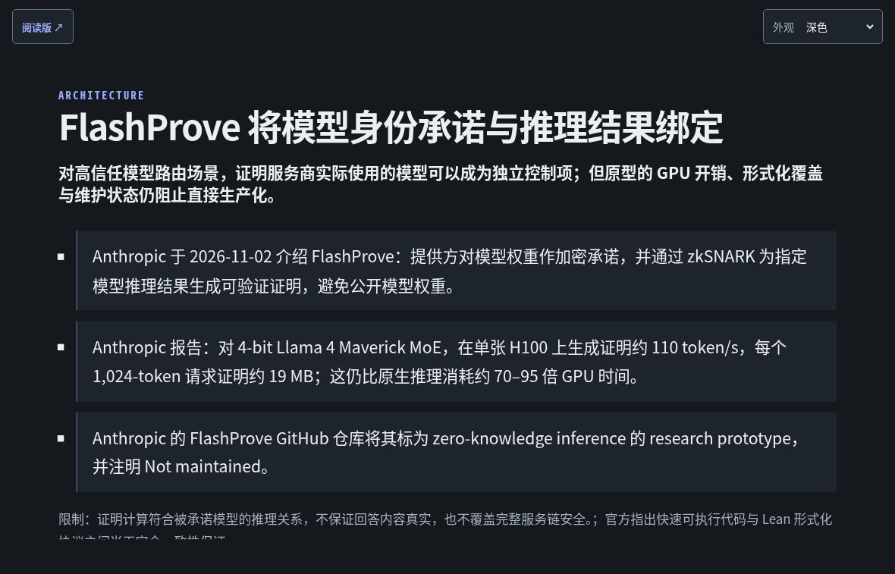
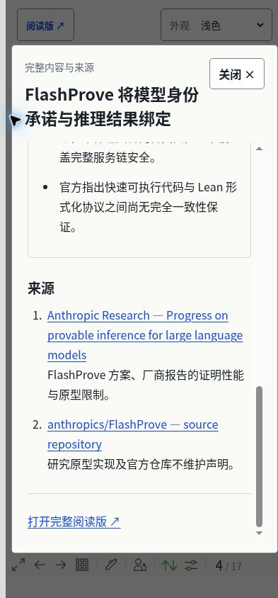
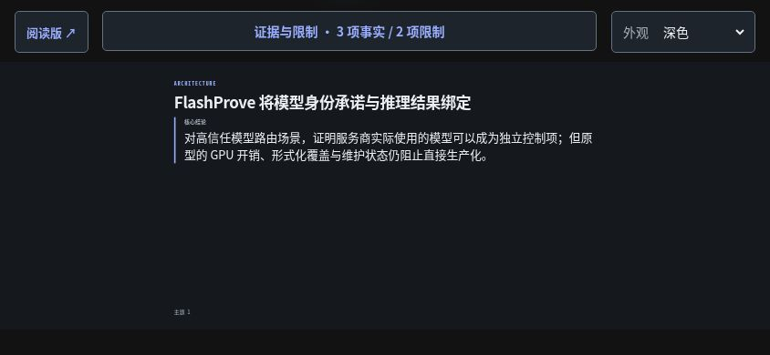
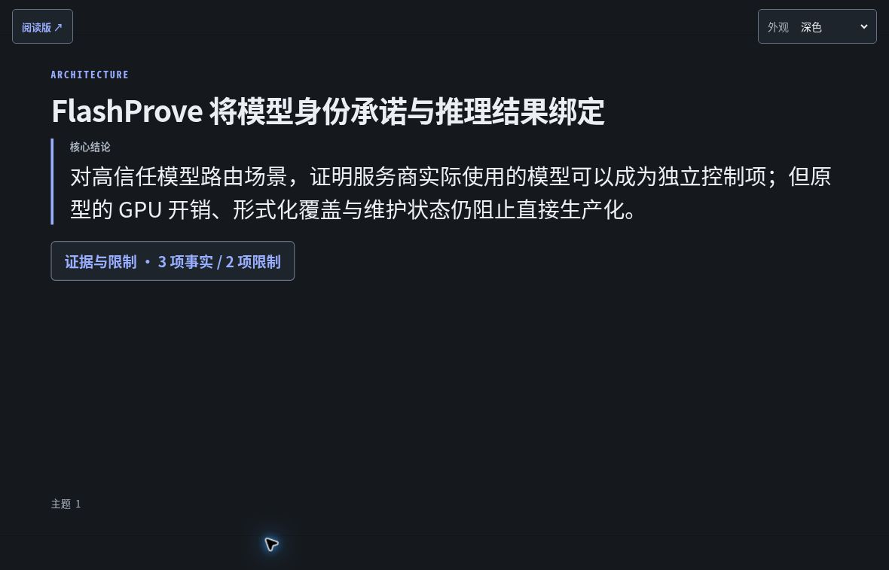

# Orbis Slide focus and overflow review

2026-11-05. Independent branch from `main` at `d9b1693`, after PR #73. This change concerns generated Daily, Weekly and Talk presentations. It does not rewrite articles, evidence records, the content schema, native author decks or the publishing workflow.

## Reproduced problem

Real browser measurements used a 980 × 551.25 logical Slidev canvas (rounded DOM client height: 552). Content outside that canvas was clipped even on desktop:

| Published example, before this change | Content height | Missing content |
| --- | ---: | --- |
| 2026-11-05 Daily, FlashProve, page 3 | 607px | Limitations cut off; source link outside canvas |
| 2026-11-05 Daily, four signals, page 2 | 604px | Lower two cards cut off |
| 2026-09-12 Daily, kernel/xPU topic, page 7 | Beyond the canvas | Third fact partially visible; fourth fact, limitations and sources absent |
| 2026-09-09 Daily, references, page 11 | 662px | Archive recommendations and reading return cut off |
| Orbis Presentation Platform Talk, page 2 | 606px | Sources outside canvas |

Weekly's sampled topic page and the native author deck did not have the same overflow. They were not treated as evidence of a universal defect.

The templates stacked a title, conclusion, every fact, limitations and references into one fixed-height page. Card padding compounded the problem. Shrinking every font or hiding overflow would leave the reading problem intact.

## Information and layout changes

- A topic slide presents the existing author's complete conclusion, including its qualifiers. A short first fact is shown only when it fits in full. The control always states the real fact and limitation counts.
- “Evidence and limitations” opens an unscaled dialog containing the full conclusion, all facts, limitations and their sources. Evidence V1 references are resolved per fact rather than linking only the first source.
- A missing limitations list is described as “原文未列出限制”, not as an absence of risk.
- Card groups use a conservative aggregate height budget. Overfull pairs become single-card pages. All summaries in the current published corpus remain complete on the main card pages.
- Reference indexes are split into short groups. Full titles, original URLs and complete support statements remain in details. Extremely long index titles use a domain/sequence label instead of an invented shorter title.
- Radar labels remain complete in the current corpus. Impact and Adoption Horizon are explicitly identified as the original 0–100 values, not days or percentages. Their original explanatory notes are available in details.
- Long titles or conclusions continue on clearly marked pages at natural boundaries. Segments reassemble to the original text. Wide Latin glyph runs have a conservative width budget too.

The result is not a mechanical paragraph-per-slide expansion: current Daily decks contain 12–18 slides, Weekly 9, and the standalone Talk 6. The latest Daily is 17 slides. Page numbers therefore change; existing numeric hash bookmarks may now point to a different topic.

## Interaction and small screens

The native modal dialog sits outside the scaled presentation canvas. It has a named heading, focus containment, Escape/close behavior, focus restoration and Slidev shortcut locking. Navigation, overview and unmount close or suppress the dialog.

The close button remains visible while the body scrolls. Normal body text is 16–17px, with 1.75 line height. Long headings remain fully accessible in a separately bounded area. Mobile/tablet controls have at least 44 CSS-pixel targets. Narrow phones use two toolbar rows; wider landscape screens use a single row and leave the slide unobstructed.

The existing three-state appearance, first/last reading links, outside-canvas reading return and static-host hash routing are retained. Native decks keep their own source, layout and controls.

## Print and export contract

Slides are a **summary view**. Expanded evidence is an interactive reading surface, not silently compressed into an exported slide image. The generated markup and print CSS include a summary-only notice and a real reading link. A standalone Talk without a reading article links to its runtime interactive deck instead. These notices are not repeated in the ordinary interactive view.

The existing production build does not enable Slidev's PDF download/print feature. Direct `#/print` therefore resolves as an ordinary slide route, not a print list. This PR does not enable that separate feature. The print/export styling is a code-level contract only; no generated PDF, print-route or physical-print success is claimed.

## Verification

- Full-text and URL preservation tests cover all 26 published generated decks. Native generation remains outside the component/template injection branch.
- Stress cases cover Chinese and Latin titles, wide unbroken Latin tokens, maximum conclusion budgets, overfull card pairs, long references, script-looking text and literal braces/`<slug>` text.
- New component tests compile the Vue script, template and scoped CSS and check the modal, route cleanup, responsive controls and print contracts.
- The complete build validates and assembles all 39 reading pages and 27 presentations. Exact-commit CI and public preview findings are recorded in the PR discussion.
- Actual browser QA covers representative Daily, Weekly, Talk and native flows, including 320/393/768 CSS-pixel viewports and 844 × 390 landscape. These are browser viewport checks, not physical-device certification.

Synthetic pages are explicitly labelled QA fixtures and are not committed or published. This is not a full screen-reader, WCAG, PDF-export, physical iOS/Safari/Android or performance certification. Old history-style `/11` URLs remain outside the supported hash-route contract.

### Final local browser findings

- FlashProve's conclusion, all 3 facts, 2 limitations and 2 sources are accessible. The denser 2026-09-12 topic retains all 4 facts, 2 limitations and both evidence sources.
- The 393px dialog keeps its 44px close button visible after scrolling to the final sources; Escape and close return focus to the opener. The final ordinary two-line heading has no stray scrollbar.
- At 844 × 390, the single-row toolbar leaves a 294px-high, unobstructed slide. Weekly's full judgment and reading link, Talk's literal `<slug>` text, zero-limitations state and native author's unchanged deck were checked.
- Synthetic 42-CJK headings, 156-CJK conclusions, wide Latin runs, oversized card pairs, 334-character source titles, 1200-character support text and a 300-CJK radar label did not overflow in the sampled viewport checks. Full details remain available, with marked continuation where needed.
- The latest Daily's final 17/17 reading return was clicked successfully. Published preview and exact-head CI still require the separate PR verification recorded there.

## Browser evidence

Before: original topic page clips limitations and its source.

After: focused original conclusion and explicit evidence/limitation counts.

Phone: complete evidence at normal text size, with a persistent close control.

Landscape: one-row controls and an unobstructed slide.

Dark theme uses the same readable hierarchy.

Signals are divided into readable groups without shortening their current summaries.

