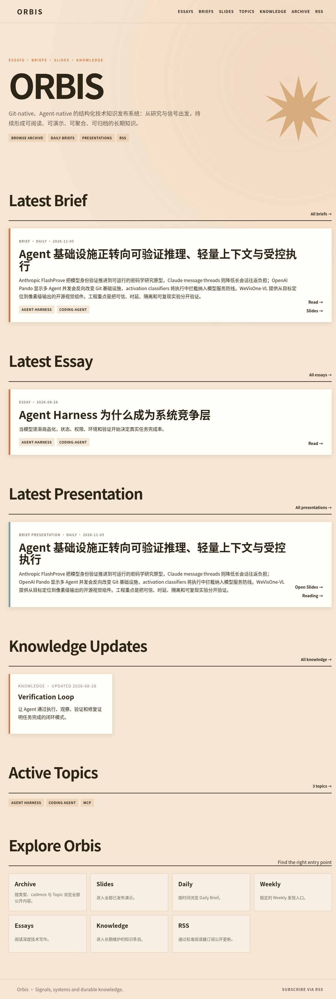
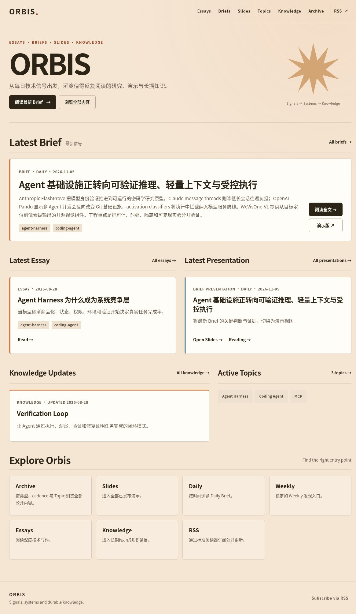
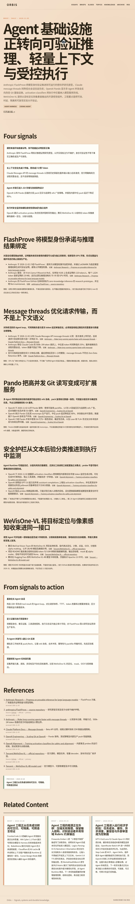
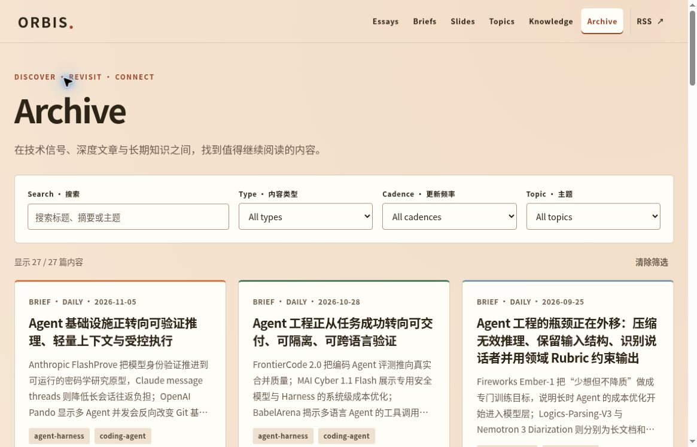
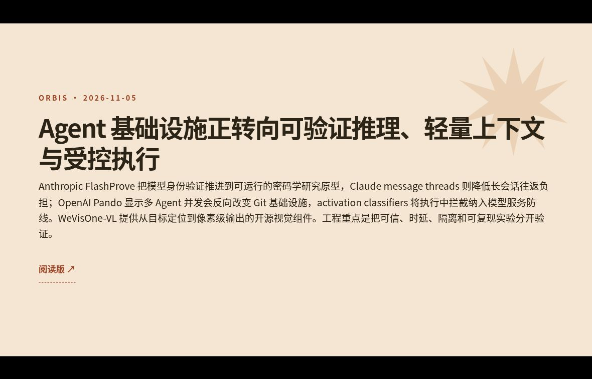
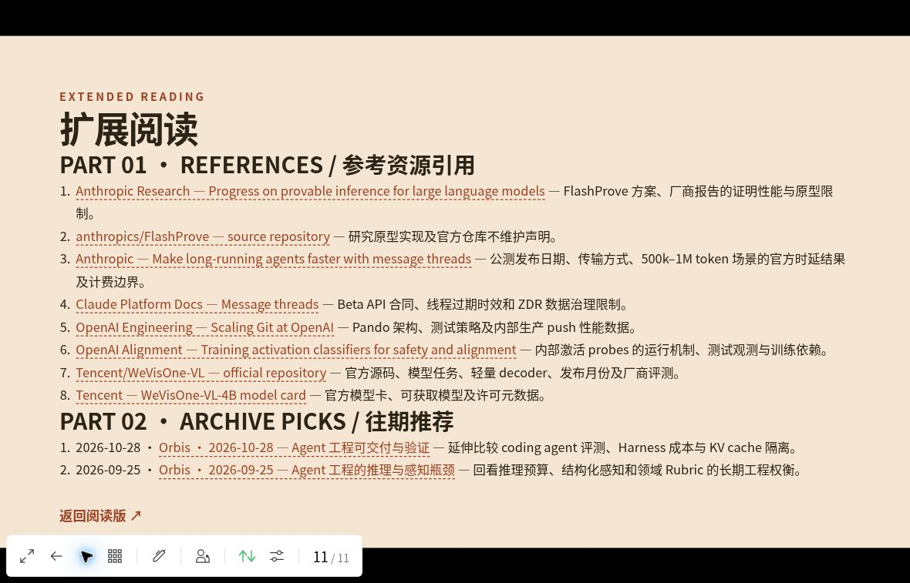
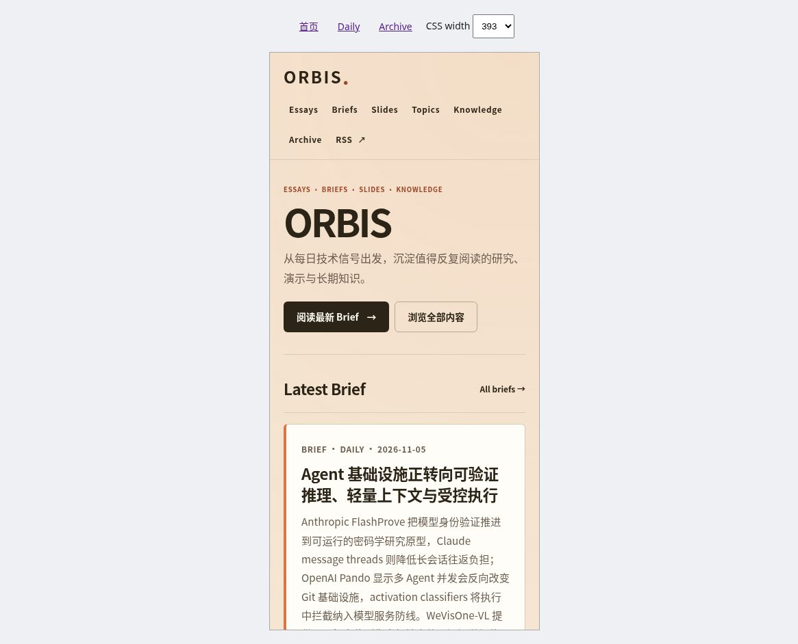
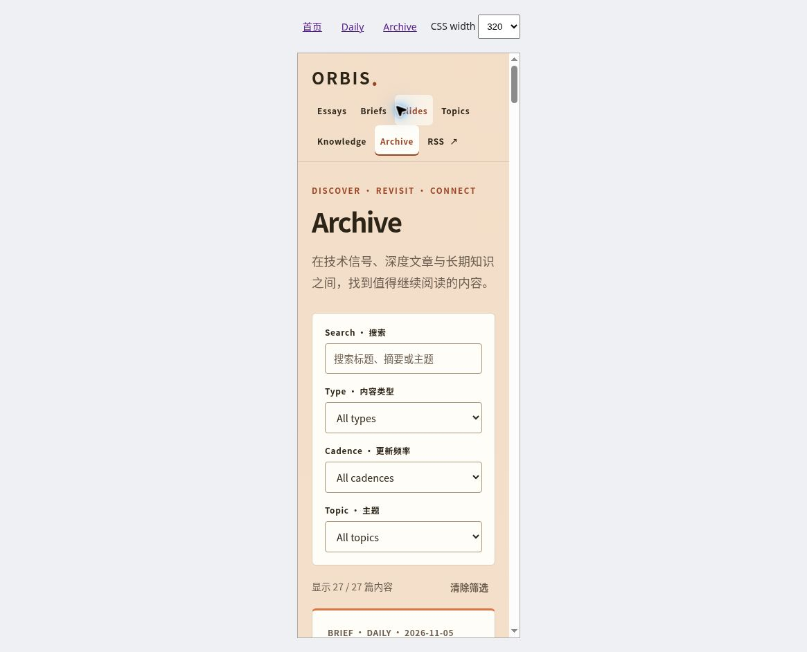

# Orbis UI 评审与优化 · 2026-11-05

## 结论与范围

基于 `main` 的 `8f6d77d` 新建 `feat/ui-reading-experience`，保留暖纸色、炭黑与橙棕品牌，优化「首页发现 → 归档筛选 → Daily 阅读 → 演示 → 返回阅读」路径。未修改发布内容、内容治理、部署工作流或共享设计 Token，未自动合并。

纳入演示回程 404 后的完整基线为 **6.2/10**，最终代表性流程评分为 **9.0/10**。初始 Web 审查为 6.6/10，首轮 Web 改版为 8.7/10；阶段性 Web 评分与完整流程评分分开记录。评分是按以下固定权重作出的启发式专业判断，不是全站 WCAG、性能或真机兼容认证。

| 维度 | 权重 | 基线 | 第一轮 Web | 最终 |
| --- | ---: | ---: | ---: | ---: |
| 品牌与视觉 | 20% | 8.0 | 8.8 | 8.8 |
| 阅读层级 | 25% | 5.5 | 8.5 | 9.0 |
| 内容发现 | 20% | 5.0 | 9.0 | 9.2 |
| 响应式 | 15% | 7.0 | 8.5 | 9.0 |
| 可访问性 | 15% | 6.0 | 8.7 | 9.0 |
| 一致性 | 5% | 5.0 | 8.5 | 9.0 |
| 加权结果 | 100% | 6.18 | 8.68 | 9.00 |

第一轮仅评估已验证的 Web 界面，未将当时未复测的 Slidev 修复算入整体通过。最终评分包含下述演示往返流程。

## 发现与迭代

1. **首页阅读入口过晚。** 原首屏被品牌标题与留白占据，最新文章在折叠线下。压缩 hero，建立一个主操作和一个次操作；精选 Brief 保持突出，Essay/Presentation 并列，去除同一 Brief 在演示卡中的重复摘要。桌面全页高度由约 3464px 降至 2006px，最新标题进入首屏（约 y=581）。
2. **Daily 标题过大。** 原桌面标题 118px、高约 510px。现在为 46.4px、高约 121px；窄屏为 28.8px。阅读列居中，正文行高与证据引用层级统一，加入回程导航与原生可折叠章节目录。首个正文标题由约 y=1132 提前至 y=746。第二轮将目录默认折叠，避免占据移动首屏。
3. **归档筛选缺少反馈与恢复。** 新增标题/摘要/主题搜索、实时结果数量、空态、一键清除、查询参数与 Back/Forward 恢复。非 Brief 类型自动清空并禁用 Cadence。发现卡摘要仅视觉截为四行，详情全文不变；卡片标题修为 h2。无 JavaScript 时全部内容仍可阅读。
4. **导航与小控件不易操作。** 主要导航、按钮、筛选、目录链接提供至少 44px 目标；增加 skip link、可见焦点、当前栏目、带内容标题的动作可访问名称与 reduced-motion 支持。
5. **浅色小字对比不足。** 强调文字改为深橙棕；元数据、辅助说明与标签统一可读颜色。计算得到强调文字对纸色 5.29:1，辅助文字对纸色 5.19:1、对白卡 6.25:1，标签 6.65:1，主按钮 15.07:1。这些比值只覆盖所列颜色组合。
6. **演示封面重叠、返回阅读 404。** 显式设置标题行高、收敛封面字号与装饰面积。Slidev 会把以 `/` 开头的 Markdown 链接转为内部路由并重复添加 base，故 Daily/Weekly/Talk 阅读链接改为转义后的原生 HTML anchor，保持生产与预览 base 路径。
7. **边界回归。** 代码复核发现字面搜索词 `all` 会被当作筛选哨兵删除。已限定哨兵只作用于类型/频率/主题，并增加 `q=all` URL 往返测试。

## 浏览器验收

- 桌面约 1180 × 757：首页、归档、空态、Daily、目录定位、Slidev 封面/末页。
- 键盘：Tab 可见焦点；skip link 实际将焦点移至 main；原生目录能展开并跳至章节，目标不被遮挡。
- 归档：搜索 `FlashProve` 得到 1/27；叠加 Essay 得到 0/27 且 Cadence 禁用；清除恢复 27/27 并聚焦搜索；Back 恢复旧状态，刷新仍保留。
- Daily：目录跳转到 Pando 段落，锚点位于视口约 y=24。
- 演示：从阅读页进入最新演示，封面标题无重叠；封面「阅读版」实点返回当天 Daily。连续翻到 11/11，全部引用与「返回阅读版」可见；末页链接再次实点成功。
- 响应式：普通浏览器缩放回流及 320/393/768 CSS px 的同源 iframe 视口验证。首页、Daily、Archive 均无水平溢出。iframe 视口是响应式布局测试，不是真机、触摸或移动浏览器模拟。

本地静态 QA 服务为 Slidev 数字页路径增加了仅预览用的 index fallback，以适配该服务的 SPA 刷新方式。此辅助文件没有进入源代码或发布产物，测试不代表已经验证新的生产部署。

## 自动验证

- `pnpm build`：通过，包括完整 validate、多演示集成夹具、39 个正式 Web 页面、27 个正式演示、组装及全部 artifact 检查。
- `pnpm test:reading-ui`：通过。覆盖搜索规范化、组合筛选、非法参数、URL 往返、`q=all`、导航语义；对 25 个公开 Daily/Weekly 的生产与预览 base 验证原生阅读链接。
- `pnpm exec tsc --noEmit --skipLibCheck --target es2022 --module ESNext apps/web/src/lib/archive-filters.ts`：通过（仅新增筛选模块的聚焦类型检查，不是全仓库类型检查）。
- `git diff --check`：通过。

本地 Node 24.22.1 / pnpm 11.24.0。受限环境中的 TypeScript 脚本使用同版 tsx 的 Node import hook 执行，未改变测试逻辑。GitHub CI 将按仓库标准工具链再次验证。

既有 `verification-loop` Knowledge 的 review overdue 警告仍保留，未作为 UI 修改而改动内容状态。没有执行屏幕阅读器完整测试、自动化 WCAG 全站扫描、浏览器禁用 JavaScript 的端到端测试、Safari/Firefox/实体设备测试或 Lighthouse 性能测量。静态内容保留属于代码与构建检查，不冒充禁用 JavaScript 的浏览器验证。

## 视觉证据

### 首页：基线与优化后

### Daily：标题与阅读层级

### 归档

### 演示与回程

### 窄屏 CSS 视口

